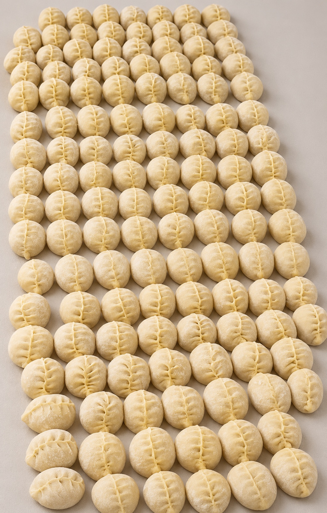
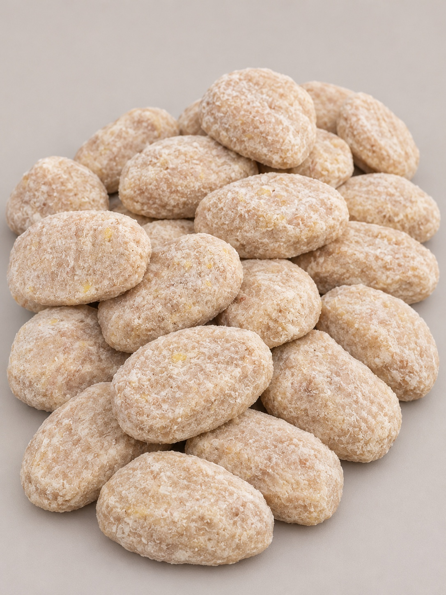
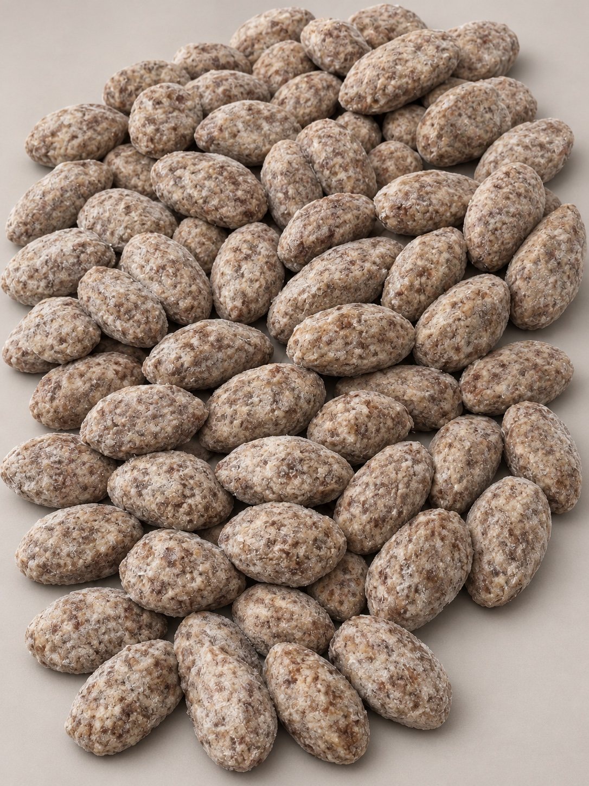
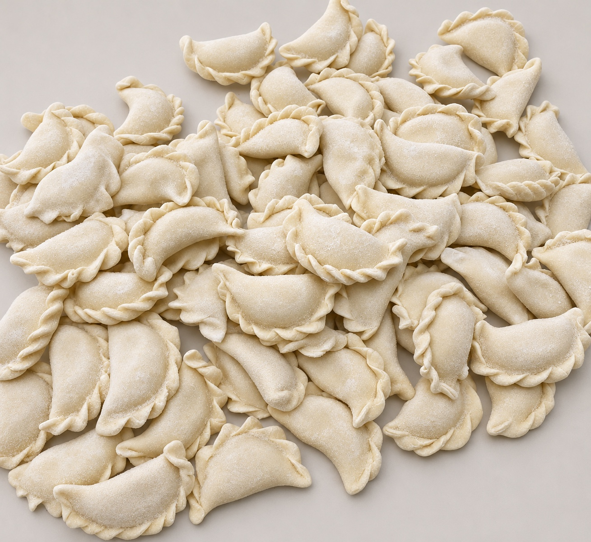
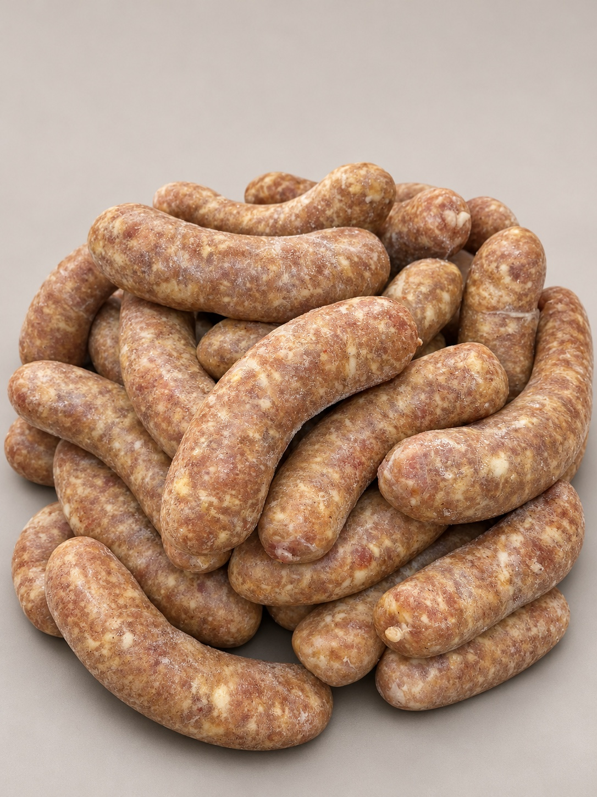
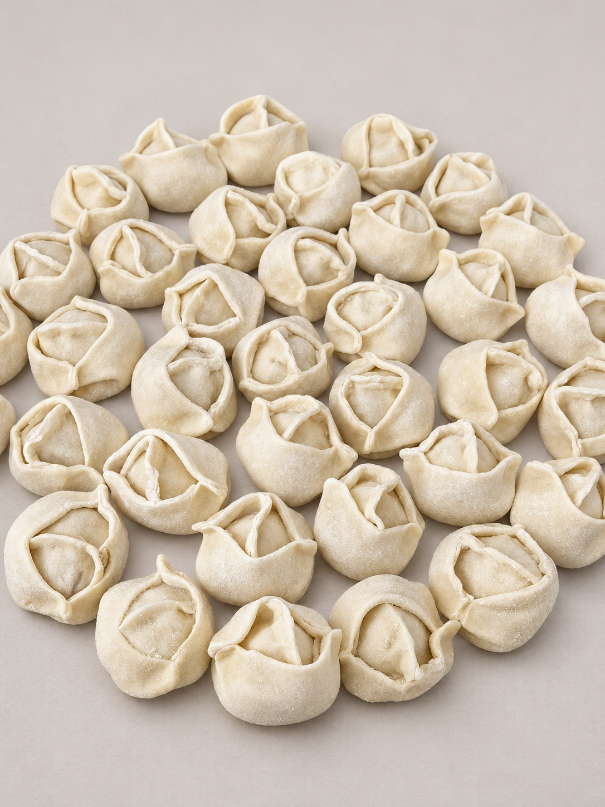
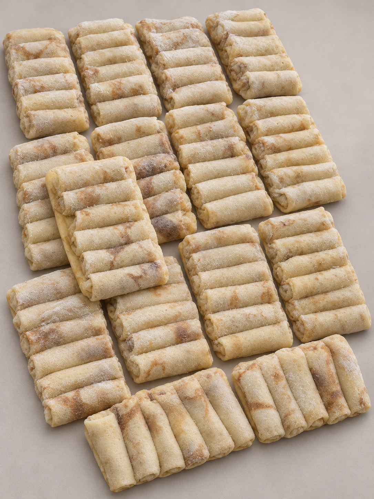

# Галерея согласования: «Домашние полуфабрикаты»

Статус: **подготовлено к согласованию; товары не опубликованы**.

Эта галерея показывает все семь обработанных фотографий, текущие имена файлов и предполагаемое соответствие подкатегориям. Она не является подтверждением ассортимента: точные названия, составы, цены, единицы продажи и наличие нужно подтвердить отдельно.

## Наглядная галерея

### 1. Предположительно: берики

Файл: `public/images/products/homemade-semi-finished/semi-beriki/beriki.jpg`
Предполагаемое наименование: **Берики — требуется подтверждение точного названия и состава**
Подкатегория: **Берики** (`semi-beriki`)

### 2. Предположительно: куриные котлеты

Файл: `public/images/products/homemade-semi-finished/semi-cutlets/chicken-cutlets.jpg`
Предполагаемое наименование: **Куриные котлеты — требуется подтверждение точного названия и состава**
Подкатегория: **Котлеты** (`semi-cutlets`)

### 3. Предположительно: мясные котлеты

Файл: `public/images/products/homemade-semi-finished/semi-cutlets/meat-cutlets.jpg`
Предполагаемое наименование: **Мясные котлеты — требуется подтверждение точного названия и состава**
Подкатегория: **Котлеты** (`semi-cutlets`)

### 4. Предположительно: вареники

Файл: `public/images/products/homemade-semi-finished/semi-dumplings/vareniki.jpg`
Предполагаемое наименование: **Вареники — требуется подтверждение точного названия и состава/начинки**
Подкатегория: **Вареники** (`semi-dumplings`)

### 5. Предположительно: купаты

Файл: `public/images/products/homemade-semi-finished/semi-kupaty/kupaty.jpg`
Предполагаемое наименование: **Купаты — требуется подтверждение точного названия и состава**
Подкатегория: **Купаты** (`semi-kupaty`)

### 6. Предположительно: манты

Файл: `public/images/products/homemade-semi-finished/semi-manti/manti.jpg`
Предполагаемое наименование: **Манты — требуется подтверждение точного названия и состава**
Подкатегория: **Манты** (`semi-manti`)

### 7. Предположительно: блины

Файл: `public/images/products/homemade-semi-finished/semi-pancakes/filled-blini.jpg`
Предполагаемое наименование: **Блины — требуется подтверждение точного названия и начинки**
Подкатегория: **Блины** (`semi-pancakes`)

## Таблица соответствия

| № | Фотография | Предполагаемый товар | Подкатегория | Путь к изображению | Статус |
|---:|---|---|---|---|---|
| 1 | `beriki.jpg` | Берики | Берики (`semi-beriki`) | `/images/products/homemade-semi-finished/semi-beriki/beriki.jpg` | Требуется подтверждение названия и состава |
| 2 | `chicken-cutlets.jpg` | Куриные котлеты | Котлеты (`semi-cutlets`) | `/images/products/homemade-semi-finished/semi-cutlets/chicken-cutlets.jpg` | Вид товара предполагается; требуется подтверждение |
| 3 | `meat-cutlets.jpg` | Мясные котлеты | Котлеты (`semi-cutlets`) | `/images/products/homemade-semi-finished/semi-cutlets/meat-cutlets.jpg` | Вид товара предполагается; требуется подтверждение |
| 4 | `vareniki.jpg` | Вареники | Вареники (`semi-dumplings`) | `/images/products/homemade-semi-finished/semi-dumplings/vareniki.jpg` | Требуется подтверждение названия и начинки |
| 5 | `kupaty.jpg` | Купаты | Купаты (`semi-kupaty`) | `/images/products/homemade-semi-finished/semi-kupaty/kupaty.jpg` | Требуется подтверждение названия и состава |
| 6 | `manti.jpg` | Манты | Манты (`semi-manti`) | `/images/products/homemade-semi-finished/semi-manti/manti.jpg` | Требуется подтверждение названия и состава |
| 7 | `filled-blini.jpg` | Блины | Блины (`semi-pancakes`) | `/images/products/homemade-semi-finished/semi-pancakes/filled-blini.jpg` | Начинка и точное название не подтверждены |

## Проверка качества и готовности к карточкам

- Все 7 файлов — JPEG в RGB, длинная сторона не превышает 1568 px; повторная обработка не выполнялась.
- Визуально у фотографий единый нейтральный фон и близкая мягкая цветопередача; явных искажений формы не обнаружено.
- На фото не видны упаковка, лотки или бытовой фон; это соответствует подготовленной версии, но права на исходные материалы и соответствие реальному ассортименту всё равно должны быть подтверждены магазином.
- Пропорции различаются: часть кадров вертикальная, `vareniki.jpg` — почти горизонтальный. На карточке каталога используется `object-cover`, поэтому края некоторых вертикальных кадров могут быть подрезаны. В детальной галерее используется `object-contain`, поэтому изображение сохраняется полностью.
- Путь в поле `photos` должен начинаться с `/images/...`, без ручного добавления `/bastaeva-meat-catalog`. При GitHub Pages-сборке `basePath` добавляется конфигурацией Next.js.

## Ограничение публикации

`data/catalog-products.json` и `productSlugs` не заполнялись. До подтверждения этой таблицы и коммерческих данных фотографии остаются только подготовленными медиафайлами и не становятся публичными товарами.
